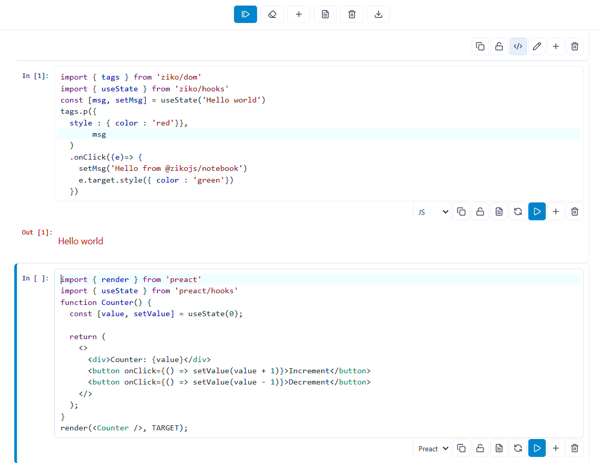

# @zikojs/notebook

A modular, extensible notebook ecosystem for interactive code cells, Markdown, and multiple JavaScript runtimes.

## Packages

### Core

- [`@zikojs/notebook`](https://www.npmjs.com/package/@zikojs/notebook) : Core notebook engine.

### Integrations

- [`@zikojs/astro-notebook`](https://www.npmjs.com/package/@zikojs/astro-notebook) : Astro integration for embedding notebooks in Astro projects.

### Runtimes

- [`@zikojs/notebook-runtime-preact`](https://www.npmjs.com/package/@zikojs/notebook-runtime-preact) : Preact runtime support.
- [`@zikojs/notebook-runtime-react`](https://www.npmjs.com/package/@zikojs/notebook-runtime-react) : React runtime support.
- [`@zikojs/notebook-runtime-svelte`](https://www.npmjs.com/package/@zikojs/notebook-runtime-svelte) : Svelte runtime support.

### Module Resolvers

- [`@zikojs/notebook-vite-resolver`](https://www.npmjs.com/package/@zikojs/notebook-vite-resolver) : Resolves installed packages for notebook cells in Vite-based projects.
- [`@zikojs/notebook-astro-resolver`](https://www.npmjs.com/package/@zikojs/notebook-astro-resolver) : Module resolution support for Astro projects.

## Documentation

See the individual package READMEs for installation instructions, configuration, and usage examples.